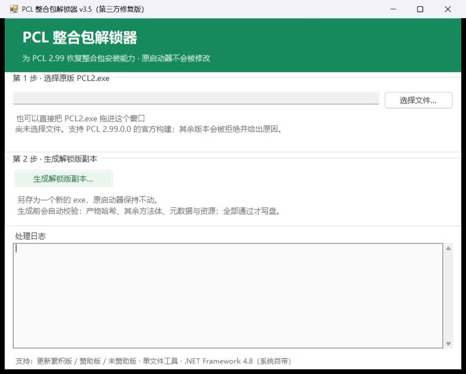

> **下载请点击右侧 Releases**（不要点 Download ZIP，那是源码）
# PCL 整合包解锁器 v4.0

[](https://github.com/cavalei/PCL2-/releases/latest)
[](https://github.com/cavalei/PCL2-/actions/workflows/build.yml)




选择受支持的 PCL 2.99 原版 EXE（2.99.0.0 / 2.99.0.1），生成一份恢复整合包安装功能的副本。原文件保持不动。

> 第三方独立工具，非 PCL 官方发布。PCL 作者：龙腾猫跃 · 赞助：<https://meloong.com/afd/a/LTCat>

---

## 这个工具是怎么来的（请先看这条）

社区里有一种说法："这玩意的源码是逆向出来的。"需要对一下概念：

| 部分 | 性质 | 是否逆向 |
|---|---|---|
| `src/` 里的工具代码（约 900 行 C#） | 手写 | 否，可直接阅读 |
| `Resources/pcl-2.99.json`（103 KB） | 从一份**按官方源码编译出的程序集**里读出的方法体 | 是"从二进制读数据"，但它是**编译产物**，不是破解 |

关键事实：官方构建把 `RestrictMcDownload` 当作 `Const` 内联，整合包安装入口被优化成**无条件抛异常**，其后的代码被编译器裁掉——所以**任何字节补丁都补不回功能**。唯一可行的办法是从"同一个源码、常量改成 False"的构建里把方法体取回来。

这项工作的可复现性已做成工具：

```powershell
# 拉 PCL 源码 → 只把 ModpackInstall 相关的常量改成 False → 编译 → 跑这个
dotnet run --project tools/ExtractPayload -- reference.exe payload.json
```

输出载荷中四个方法的校验哈希，与仓库里的 `Resources/pcl-2.99.json` **逐项一致**。完整步骤和哈希见 **[docs/PROVENANCE.md](docs/PROVENANCE.md)** 与 **[docs/VERIFICATION.md](docs/VERIFICATION.md)**。

---

## 使用

双击 `PclModpackEnabler.exe`：

1. **第 1 步**：选择或拖入原版 `PCL2.exe`，界面会立即显示识别到的版本和 SHA-256
2. **第 2 步**：点"生成解锁版副本…"，选择保存位置
3. 下方日志会给出输入哈希、输出哈希和校验结果

命令行（与 GUI 共用同一套保护）：

```powershell
./PclModpackEnabler.exe --input original.exe --output patched.exe
./PclModpackEnabler.exe --input original.exe --output patched.exe --verify
./PclModpackEnabler.exe --input original.exe --output patched.exe --force
```

- `--verify` 只读校验已有输出，不写文件
- `--force` 只允许替换其他输出文件，不绕过输入白名单，不允许覆盖原文件

---

## 支持版本

| 输入 | 长度 | 输入 SHA-256 | 输出 SHA-256 |
|---|---|---|---|
| 累积更新版 | 5,985,280 | `5B64D6D540C37639…` | `4B4AAF8F874A3C5C…` |
| 赞助版 | 5,985,280 | `4C3091AAAC6E53D9…` | `EBA6BC071C2CD91C…` |
| 未赞助版 | 5,980,160 | `6B6E1260CB5A1D6A…` | `FAB00425CE42A065…` |
| 官方构建 `014C81FD` | 5,985,280 | `014C81FDC1DAFA68…` | 指纹校验（不固定哈希） |

已知构建的完整哈希见 `Resources/versions.json`。除此之外，工具会按**方法体指纹**识别构建（`Resources/signatures.json`），因此同一份源码在不同时间编译出的文件也能处理——不依赖文件哈希。若文件已被其它工具改过，会提示「该版本已被解锁下载，无法确认文件安全性，请使用原版重试！」

---

## 补丁范围

| 方法 | 修改 |
|---|---|
| `PageDownloadInstall.LoaderInit()` | 重建 18 条指令，保留完成回调 |
| `ModModpack.ModpackInstall()` | 重建 41 条指令 |
| `ModModpack.ModpackInstall(String,String,String)` | 重建 330 条指令、3 个 EH |
| `PageDownloadResourceDetail.InitializeStackResourceVersions(StackPanel)` | 重建 196 条指令、2 个 EH，恢复"安装"回调 |
| `PageDownloadModify.LoadInstanceFinished(...)` | 按字段/getter/setter 指令序列定位，仅把 `Collapsed` 改成 `Visible` |

成员按目标模块的完整签名解析；内部或外部成员缺失一律拒绝，不猜测、不联网、不自动导入其它程序集。其余方法逐条核对（累积更新版共 6334 个）。

---

## 仓库结构

```
├─ src/                     工具源码（约 900 行）        → docs/SOURCE-MAP.md
├─ Resources/               IL 载荷 + 版本白名单
├─ tools/ExtractPayload/    载荷提取器（可复现来源）
├─ tests/                   23 条断言
├─ docs/
│  ├─ PROVENANCE.md         数据从哪来、怎么复现
│  ├─ VERIFICATION.md       自己动手验证的步骤
│  ├─ SOURCE-MAP.md         逐文件说明
│  ├─ FIXES.md              本次修复清单
│  ├─ PCL-UPSTREAM-LICENCE.txt
│  └─ THIRD-PARTY-NOTICES.txt
├─ build.ps1 / test.ps1
└─ .github/workflows/build.yml
```

---

## 构建

```powershell
./build.ps1                                  # 需要 .NET SDK 9
./build.ps1 -PackageSource ./local-packages  # 离线：指定本地包源
./test.ps1                                   # 回归测试
```

产物 `dist/PclModpackEnabler.exe`（单文件，net48，无需安装 .NET 9）。依赖 dnlib 与 JSON 库在构建时内嵌，仓库不提交依赖 DLL 或任何 PCL EXE。

工具自身哈希随编译器版本变化，**不承诺逐字节可复现**；承诺的是行为与产物一致（见 `docs/VERIFICATION.md`）。

---

## 署名与许可

- 方法体载荷来自群友提供的 dnlib 方案，本仓库补齐 GUI、三版本白名单、MaxStack 修复、单文件打包与可复现提取工具
- 载荷属于 PCL 派生数据，**不受本仓库 MIT 许可重新授权**；上游许可见 `docs/PCL-UPSTREAM-LICENCE.txt`
- dnlib、JSON 库许可见 `docs/THIRD-PARTY-NOTICES.txt`
- 修改启动器行为可能违反其使用条款，风险自担
